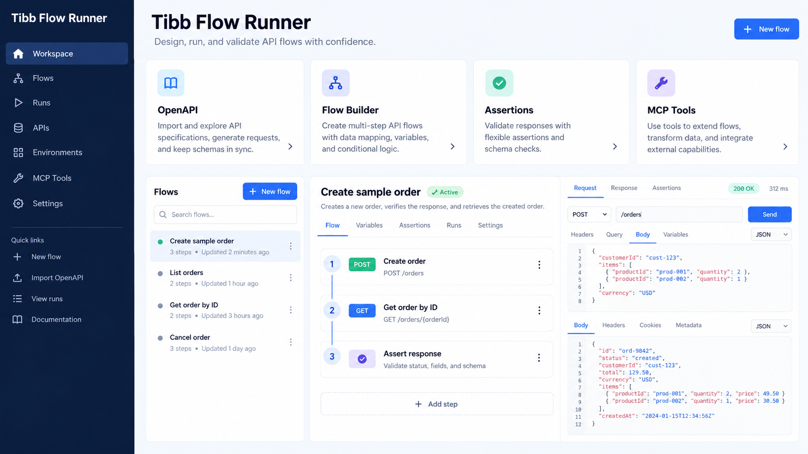
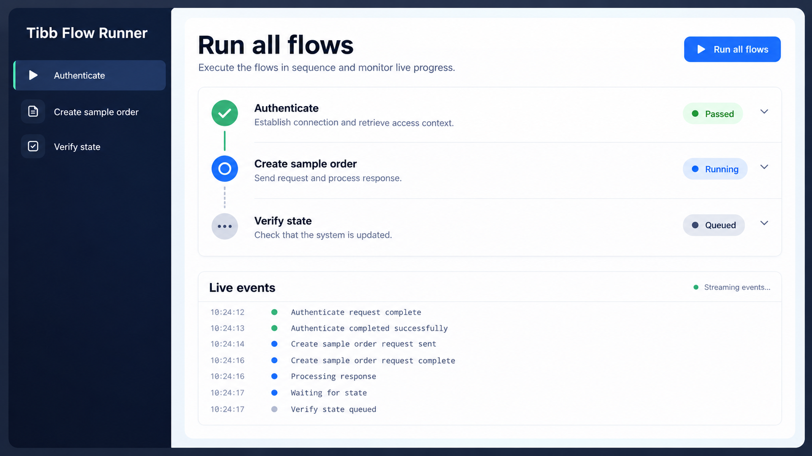

# Tibb Flow Runner

An OpenAPI-driven API flow runner for building, validating, and executing backend QA scenarios. It includes a visual dashboard, a Python flow SDK, an MCP server for AI-assisted flow authoring, and a workspace runner that executes every flow sequentially with live status updates.

<p align="center">
  
</p>

## What it does

- Builds API clients from an OpenAPI specification at runtime.
- Models tests as reusable flow graphs with calls, conditions, branches, splits, and teardown steps.
- Supports status, JSON, dynamic-reference, and persistence/state assertions.
- Provides `assert: true` conditions so a failed predicate fails the flow directly.
- Handles retries, backoff, `wait`, and `wait_until` for asynchronous systems.
- Runs all workspace flows in sequence and reports which flow is running, passed, or failed.
- Exposes workspace and flow operations through an MCP server for compatible AI tools.

## Live workspace runs

Run an entire workspace in order and follow each flow as it passes, fails, or waits. The illustrative screen below uses generic sample flow names and contains no local workspace data.

<p align="center">
  
</p>

## Quick start

Requirements: Python 3.11 or later.

```bash
git clone <your-repository-url>
cd tibb-flow-runner
python -m venv .venv
.venv/bin/pip install -e ".[stub,dev]"
cp .env.example .env
```

Start the dashboard:

```bash
.venv/bin/python scripts/run_dashboard.py
```

Open `http://127.0.0.1:8800`. The dashboard can create workspaces, inspect OpenAPI-backed operations, edit flow graphs, run an individual flow, or run every workspace flow sequentially.

## Running flows

Run flow files from a path:

```bash
.venv/bin/python -m runner.cli run flows/examples
```

Run every flow in a workspace, in order:

```bash
.venv/bin/python -m runner.cli run-workspace default
```

Use `--json` on either command for machine-readable reports. The workspace runner continues after a failure so its final report shows the outcome of every flow; each flow's `finally_steps` still run for cleanup.

The default workspace is generated locally on first use from the tracked specifications. Add your own flow graphs to a workspace or use the Python SDK to define them. Workspace files are deliberately ignored by Git because they can contain mutable test state and local secrets.

## MCP server

Run the MCP server over stdio:

```bash
.venv/bin/python scripts/mcp_server.py
```

For an SSE server instead:

```bash
.venv/bin/python scripts/mcp_server.py --sse --port 8805
```

The MCP tools cover workspace management, OpenAPI inspection, graph validation, flow creation and execution, and sequential workspace runs. Large list responses are bounded/paginated by the server so clients do not exceed event-size limits.

## Flow capabilities

Flows are JSON graphs (or Python SDK definitions) composed of API calls and control nodes. Values can reference context captured by earlier steps, for example:

```json
{
  "kind": "assert",
  "left": "$response.patient_id",
  "operator": "equals",
  "right": "$ctx.dependent.id"
}
```

Use an asserting condition when a branch must be true rather than merely selecting an `else` branch:

```json
{
  "kind": "condition",
  "assert": true,
  "predicate": { "left": "$response.patient_id", "operator": "equals", "right": "$ctx.dependent.id" },
  "then_steps": []
}
```

The graph validator checks structure before execution and can use the loaded OpenAPI schema to flag missing required request arguments.

## Development

Run the focused regression checks:

```bash
.venv/bin/pytest -q \
  tests/test_runner_primitives.py \
  tests/test_conditionals.py \
  tests/test_workspace_runner.py \
  tests/test_mcp_handshake.py
```

See [CONTRIBUTING.md](CONTRIBUTING.md) for contribution guidance.

## Security and test data

Do not put production credentials, patient information, or other sensitive data in a flow, specification, or commit. Put local configuration in `.env` and workspace secrets in the dashboard/workspace state; both are excluded from version control. See [SECURITY.md](SECURITY.md) for reporting guidance.

## License

This project is licensed under the [MIT License](LICENSE).
